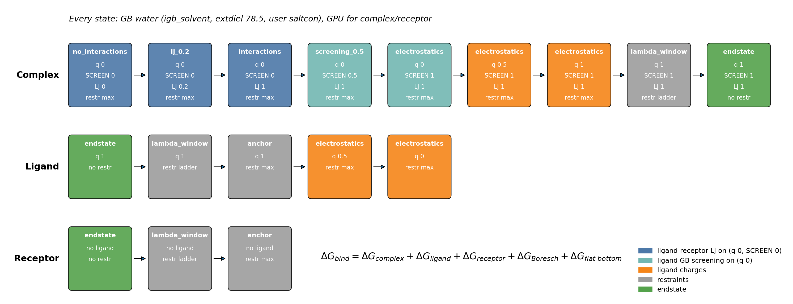

.. _in-solvent-protocol:

Running the in-solvent (paper) protocol
=======================================

What it is and why it exists
----------------------------

The gas-phase cycle takes the ligand out through vacuum. On the way it needs a band of GB
windows where the external dielectric (``extdiel``) is stepped down from water to gas.
``pmemd.cuda`` ignores ``extdiel`` in GB MD, so on a GPU those windows quietly sample water.
On CPU the band is sampled correctly, but the protein reorganises inside it and the overlap
between neighbouring windows collapses.

The in-solvent cycle never leaves water. The ligand is switched off inside GB water, so there
is no gas state and no ``extdiel`` band, and every complex and receptor window can run on
``pmemd.cuda``. The end states are the ones the gas-phase cycle connects: the bound complex in
water, the free ligand in water, and a ligand that no longer interacts with anything. The
result is still an absolute binding free energy.

It is off by default. Turn it on with ``decouple_in_solvent: True``; with the switch off, the
gas-phase cycle runs as before.

The complex leg
---------------

Every state runs with ``igb = igb_solvent``, ``extdiel = 78.5`` and your ``saltcon``. Read the
table top to bottom to follow the ligand from bound to fully decoupled.

.. list-table::
   :header-rows: 1
   :widths: 36 12 14 16 22

   * - State
     - Ligand charge
     - Ligand GB ``SCREEN``
     - Ligand-receptor LJ
     - Restraints
   * - End state (bound complex)
     - 1
     - 1
     - 1
     - none
   * - ``lambda_window`` (restraint ladder)
     - 1
     - 1
     - 1
     - weakest to strongest
   * - ``electrostatics`` (``charges_lambda_window``)
     - 1 down to 0
     - 1
     - 1
     - anchor
   * - ``screening_<s>`` (``screening_windows``)
     - 0
     - s
     - 1
     - anchor
   * - ``interactions``
     - 0
     - 0
     - 1
     - anchor
   * - ``lj_<s>`` (``lj_scale_windows``)
     - 0
     - 0
     - s
     - anchor
   * - ``no_interactions``
     - 0
     - 0
     - 0
     - anchor

"Anchor" is the strongest step of the restraint ladder: the conformational restraints plus the
Boresch orientational restraints. In the example config that is 16 kcal/mol/A^2 for the
conformational and Boresch distance terms and 256 kcal/mol/rad^2 for the Boresch angles and
dihedrals. The full-charge ``electrostatics`` state is the top of the ladder, so that
Hamiltonian is only simulated once.

Why charges, then screening, then LJ? Charges come off first, while the ligand still has its
full LJ core. LJ is scaled linearly with no soft-core, so a charged ligand atom should never
lose its repulsion. An uncharged ligand still descreens the receptor's charged atoms and
changes their effective Born radii, so screening is a real step of its own. Taking it out
while LJ is still on means the ligand never overlaps receptor atoms it is still screening. LJ
goes last. With charge, ``SCREEN`` and LJ all at 0, the complex reproduces the apo receptor exactly
on every engine (checked with ``scripts/ingb_decouple_check.py``).

The ligand and receptor legs
----------------------------

The ligand leg goes from its end state through the restraint ladder, then turns the charges
from 1 to 0 in water. The top of the ladder is the full-charge state, so there is no separate
q = 1 window.

It has no screening or LJ step, and it does not need one. In GB there are no solvent atoms,
so the free ligand has nothing to share LJ with, and with ``gbsa = 0`` there is no surface
term. Its own intramolecular LJ stays on in every state. Once its charges are 0, nothing in the
system carries a charge, so its ``SCREEN`` value cannot change any energy. In the complex the
same uncharged ligand still screens the receptor's charges. That is the only place screening
has to be switched off.

The receptor leg goes from its end state through the restraint ladder to the anchor. There is
no GB-dielectric band and no ``no_gb`` state: ``workflow.remove_GB_solvent_receptor`` is forced
off when the in-solvent cycle is on.

The binding free energy adds the three legs to the Boresch term, as in the gas-phase cycle. The
flat-bottom term is written to the output but not added: the complex end state is already
sampled with the flat-bottom restraint on.

         LJ and restraint state of every window.
   :width: 100%

Config keys
-----------

All of these live under ``workflow.intermediate_states_arguments``. The values are the ones in
the example config.

.. code-block:: yaml

    workflow:
      intermediate_states_arguments:
        mdin_intermediate_file: script_examples/four_fento_time_step_mdin_template.mdin  # gbsa = 0
        charges_lambda_window: [0.5, 1.0]  # 0 and 1 are always added
        decouple_in_solvent: True          # decouple in GB water, not the gas phase
        gb_extdiel_windows: []             # must be empty
        lj_scale_windows: [0.2]            # between no_interactions (0) and interactions (1)
        screening_windows: [0.5]           # between interactions (0) and electrostatics q = 0 (1)

.. list-table::
   :header-rows: 1
   :widths: 26 14 60

   * - Key
     - Default
     - What it does here
   * - ``decouple_in_solvent``
     - ``False``
     - Switches to the in-solvent cycle.
   * - ``screening_windows``
     - ``[]``
     - Ligand ``SCREEN`` scales for the complex screening step. Values must be strictly
       between 0 and 1, and the key needs ``decouple_in_solvent: True``.
   * - ``lj_scale_windows``
     - ``[]``
     - Ligand-receptor LJ scales for the complex LJ step, strictly between 0 and 1.
   * - ``charges_lambda_window``
     - ``[]``
     - Ligand charge fractions. 0 and 1 are always added.
   * - ``gb_extdiel_windows``
     - ``[]``
     - Must stay empty. This cycle has no GB-dielectric band.

These rules are checked when the config loads, before any job starts:

* ``gb_extdiel_windows`` must be empty.
* ``screening_windows`` must lie strictly in (0, 1).
* The intermediate mdin template must have ``gbsa=0``, or no ``gbsa`` line at all. Otherwise
  the decoupled ligand would still change the receptor's surface area.
* ``workflow.remove_GB_solvent_receptor`` is switched off for you. There is no error.

How to run it
-------------

Start from ``script_examples/config_files/in_solvent_paper.yaml``. It runs the paper protocol
on the CB7/M01 host-guest system that ships with the repo: REMD at the three end states,
Boresch restraints plus the pairwise conformational network on the complex, 33 restraint
windows, and one intermediate window each for charge (0.5), screening (0.5) and LJ (0.2).
That comes to 39 complex, 35 ligand
and 33 receptor windows, each 10 ns long (``nstlim = 2500000`` at ``dt = 0.004`` in the mdin
template).

The paths in the file are relative to the repository root, so start the run from there:

.. code-block:: bash

    cd Impicit-Solvent-DDM
    run_implicit_ddm.py file:jobstore_cb7 \
        --config_file script_examples/config_files/in_solvent_paper.yaml \
        --workDir /scratch/$USER/cb7_in_solvent

Add ``--maxCores N`` to cap the number of cores the run may use.

For your own system, copy the file and change ``endstate_parameter_files``,
``AMBER_masks`` and ``restrained_receptor_atoms``. Keep ``gbsa = 0`` in whatever mdin template
you use. To match the paper's end-state sampling, raise ``numexchg`` in
``script_examples/endstate_templates_required/remd.template`` from 250000 to 2500000 (10 ns at
4 fs).

**CPU or GPU.** The example runs on CPU with ``pmemd.MPI``, as in the paper. For GPU, change
two keys:

.. code-block:: yaml

    hardware_parameters:
      executable: pmemd.cuda
      CUDA: True

The REMD end states then run on ``pmemd.cuda.MPI``, which is derived from ``executable``. Set
``remd_accelerators`` to the number of GPUs each REMD job gets; the replicas share them, which
needs MPS. If your AMBER build has no ``pmemd.cuda.MPI``, or you want the replica ladder on
CPU, set ``remd_executable: pmemd.MPI`` and ``remd_accelerators: 0``.

conda-forge ``ambertools`` gives you ``sander``, ``cpptraj`` and ``tleap`` but no ``pmemd``,
``pmemd.MPI``, ``pmemd.cuda`` or ``sander.MPI``. Both the CPU example and any GPU run need a
full AMBER install on ``PATH``, for example a cluster module.

On GPUs, several windows can share one card under CUDA MPS (``windows_per_gpu``). On an MCL-1
window on an RTX 5000 Ada, four windows per GPU gave 3,327 ns/day of total throughput against
1,735 ns/day for one, with identical energies. :doc:`gpu_packing` covers the Slurm job, the MPS
setup and the full benchmark.

**Optional refinement.** Post-production ALS adds windows wherever neighbouring states overlap
poorly. Turn it on with ``workflow_jobs.adaptive_lambda: True``. In this cycle it fills the
restraint, charge, LJ and screening bands. The paper runs left it off. Details are in
``docs/post_production_als.md``.

**Faster analysis.** By default each leg is analysed with one MBAR over all of its windows, so
every window's frames are re-scored at every other window: N\ :sup:`2` energy evaluations. With
``post_analysis_block_size: K`` under ``intermediate_states_arguments``, each leg is solved as a
chain of K-window MBAR blocks and only the evaluations those blocks need are run. ``2`` is the
adjacent-window BAR chain (3N - 2 evaluations); a larger K pools more windows per solve. The
example configs carry this option commented out. See :ref:`block-mbar` for the details,
including how it works with ALS.

Common errors
-------------

``decouple_in_solvent has no GB-dielectric band; remove gb_extdiel_windows``
    Set ``gb_extdiel_windows: []`` or delete the key.

``screening_windows requires decouple_in_solvent: True``
    Screening windows only exist in the in-solvent cycle. Turn it on, or remove them.

``screening_windows must lie strictly between 0 and 1, got [...]``
    0 and 1 are the ``interactions`` and ``electrostatics`` q = 0 states, which always run.
    List only the values in between. ``lj_scale_windows`` follows the same rule.

``decouple_in_solvent requires gbsa=0 in the MDIN template``
    Set ``gbsa = 0`` in ``mdin_intermediate_file``, or delete the line.

No error, wrong answer
    A gas-phase cycle with ``gb_extdiel_windows`` on ``pmemd.cuda`` is not caught by any
    check, and its GB-dielectric windows sample water. On GPU, use ``decouple_in_solvent``.
